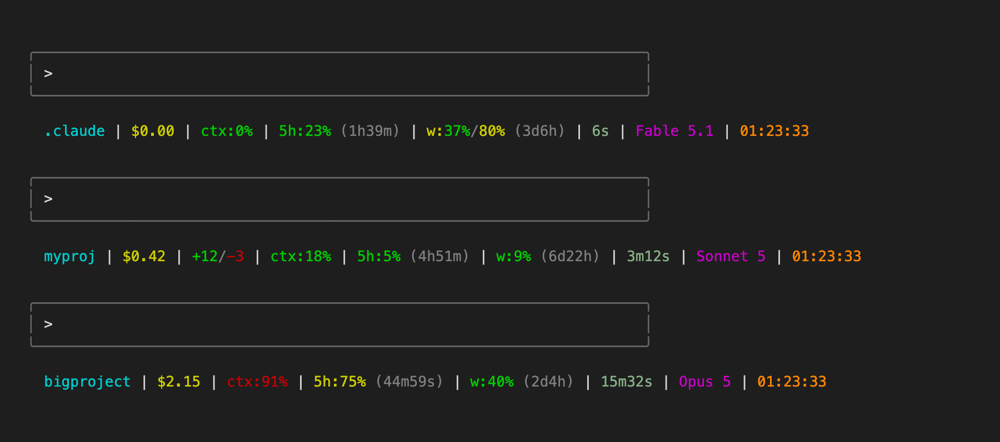

**English** | [Русский](README.ru.md)

# claude-code-statusline

[](https://github.com/kskadart/claude-code-statusline/actions/workflows/ci.yml)

A status line for [Claude Code](https://claude.com/claude-code). It runs on
every render, below the chat, and shows the project folder, session cost,
and context window usage. It also shows how much of your 5-hour and 7-day
rate limit you've used, when each one resets, how long the session has run,
the selected model, and the clock. You install it as a single binary plus one line in
`settings.json`.



## Example

```
.claude | $0.00 | ctx:0% | 5h:23% (1h39m) | w:37%/80% (3d6h) | 6s | Fable 5.1 | 12:30:13
```

The `+add/-del` segment appears only when the session has added or removed
lines; here the model has no weekly-usage row of its own, so `w` shows only
the all-model value:

```
myproj | $0.42 | +12/-3 | ctx:18% | 5h:5% (4h51m) | w:9% (6d22h) | 3m12s | Sonnet 5 | 09:04:21
```

## What each segment means

| Segment | Source (stdin JSON field) | Meaning | Color thresholds |
|---|---|---|---|
| dir | `workspace.current_dir` | Last path component; `~` if it equals `$HOME` | cyan, no thresholds |
| cost | `cost.total_cost_usd` | Session cost so far, `$X.XX` | yellow, no thresholds |
| `+add/-del` | `cost.total_lines_added` / `total_lines_removed` | Lines changed this session; hidden when both are 0 | green `+`, red `-` |
| ctx | `context_window.used_percentage` | Context window fill | green <70, yellow 70-89, red ≥90 |
| 5h | `rate_limits.five_hour.used_percentage`, `resets_at` | 5-hour rate limit usage and time to reset (`XdYh` / `XhYm` / `XmYs` / `Xs` / `now`) | green <70, yellow 70-89, red ≥90 |
| w | `rate_limits.seven_day.used_percentage`, `resets_at` (all models); the usage endpoint's `limits[]` (current model) | Weekly rate limit usage: all models, then `/` and the current model's own weekly usage when the usage endpoint reports one; one reset countdown when both windows reset together, otherwise one per value; hidden entirely when neither value is known; renders `w:-/NN%` (the `-` gray) when only the model's own value is known | the `w:` label takes the color of the higher (worse) of the two values; all-model percent green <70, yellow 70-89, red ≥90; the `/` separator and any `-` gray; model percent by its own thresholds |
| duration | `cost.total_duration_ms` | Session wall-clock duration | sage, no thresholds |
| model | `model.display_name`, falling back to `model.id` | Selected model; hidden when stdin names no model | magenta, no thresholds |
| clock | local `date` | Current local time | orange, no thresholds |

## Requirements

- Claude Code with `statusLine` support
- curl — needed for the rate-limit fallback and for the per-model weekly
  usage (both macOS-only, see below)
- for development: Rust via [rustup](https://rustup.rs), plus jq, perl,
  shellcheck, bats

The main path (data from stdin) works on macOS and Linux. Both the
rate-limit fallback and the per-model weekly usage (see below) are
macOS-only because they read the Keychain with `security`; on Linux the
per-model fetch is skipped without even trying, since `security` isn't on
PATH there, and the fallback silently finds no token.

## Install

### Prebuilt binary

Download the binary for your platform, then add the `statusLine` block to
`~/.claude/settings.json`. Targets: `aarch64-apple-darwin`, `x86_64-apple-darwin`, `x86_64-unknown-linux-musl`, `aarch64-unknown-linux-musl`.

```bash
target=aarch64-apple-darwin  # pick yours from the list above
curl -fsSL "https://github.com/kskadart/claude-code-statusline/releases/latest/download/claude-code-statusline-$target.tar.gz" | tar -xz -C ~/.claude
```

```json
{
  "statusLine": { "type": "command", "command": "~/.claude/claude-code-statusline", "padding": 2 }
}
```

### With Cargo

With a Rust toolchain from [rustup](https://rustup.rs), build it yourself and
point `~/.claude/settings.json` at the result:

```bash
cargo install --git https://github.com/kskadart/claude-code-statusline --locked
```

```json
{
  "statusLine": { "type": "command", "command": "~/.cargo/bin/claude-code-statusline", "padding": 2 }
}
```

To upgrade, repeat the same steps. If you installed the old `statusline.sh`,
remove `~/.claude/statusline.sh` after switching the command.

## Configuration

- `CLAUDE_STATUSLINE_CACHE_DIR` — where the fallback rate-limit cache is
  written. Default: `~/.claude/cache`.
- `CLAUDE_STATUSLINE_MODEL_LIMIT` — set to `0` to disable the per-model
  weekly-usage fetch described below and show only the all-model `w:` value.
  Default: enabled.

## How rate limits are obtained

1. First choice: the `rate_limits` field in the JSON Claude Code pipes to
   the program on stdin. Current Claude Code versions populate this, and
   that's all the program needs for the `5h` and `w` segments.
2. Fallback, only if that field is missing: the program reads the OAuth
   token that Claude Code itself stores in the macOS Keychain (item
   `Claude Code-credentials`) and queries
   `https://api.anthropic.com/api/oauth/usage` with the header
   `anthropic-beta: oauth-2025-04-20`. The response is cached for 60s in a
   file with mode `600`; the request has a 2s timeout.

   **This fallback endpoint is unofficial and undocumented.** It can change
   or disappear without notice. The token is sent only to
   `api.anthropic.com`, nowhere else. If this isn't acceptable for you,
   remove the fetch from `collect` in `src/main.rs` and rebuild — the stdin
   path keeps working on its own.

3. The current model's own weekly usage — the second value of the `w:`
   segment, after a gray `/` — is not part of stdin at all — Claude Code's
   `rate_limits` field has no per-model breakdown. The program identifies
   the current model from stdin's `model.display_name`/`model.id`, the
   same name the model segment shows.
   Whenever a model name is known, the program fetches the weekly usage from
   the same
   `https://api.anthropic.com/api/oauth/usage` response's `limits[]` array
   (same OAuth token, same unofficial-endpoint caveat as above), at most
   once per render, and picks the entry that scopes to the current model.
   When stdin already provided `rate_limits` (so this fetch is the only
   reason to call the endpoint), the cache TTL is 300s instead of 60s, so
   the model's weekly usage is refreshed at most every 5 minutes. The
   matching rule: the first `limits[]` entry with `kind == "weekly_scoped"`
   whose `scope.model.display_name` matches the current model
   case-insensitively (the stdin `model.display_name` starts with it; if
   there is no display name, `model.id` contains it). Set
   `CLAUDE_STATUSLINE_MODEL_LIMIT=0` to disable this fetch and show only
   the all-model `w:` value, as before this feature existed.

   curl honors `HTTPS_PROXY`/`CURL_CA_BUNDLE`; behind a TLS-intercepting
   proxy, give curl the proxy's CA via `CURL_CA_BUNDLE`, otherwise the
   fetch fails silently and only the all-model `w:` value is shown.

4. A failed fetch (no token, curl error, invalid JSON) leaves a
   `statusline-ratelimit.json.fail` marker (mode `600`) next to the cache,
   so the program backs off and doesn't retry until that marker is older
   than the same TTL that applies to the cache; a successful fetch clears
   it. An existing, older cache is still used for rendering even while a
   refresh is skipped or fails.

## Design notes

- It runs on the hot path — once per render. The usual render starts no
  processes at all; `security` and `curl` run only when the cache needs a
  refresh. No `git` calls (branch info is intentionally not shown).
- If you change the segment layout, update the doc comment on `render` in
  `src/render.rs` to match.
- The program's own working directory is not the session's working
  directory — the folder shown always comes from `workspace.current_dir`.

## Development

```bash
cargo fmt --check
cargo clippy --all-targets -- -D warnings
cargo test
cargo build --release
bats tests/
shellcheck docs/render-screenshot.sh tests/stubs/*
```

Install Rust with [rustup](https://rustup.rs), then the other tools:

```bash
# macOS
brew install shellcheck bats-core jq

# Debian/Ubuntu
sudo apt-get install -y shellcheck bats jq
```

Unit tests live next to the code in `src/`. `tests/statusline.bats` runs the
release binary end to end.

Tests never touch the real Keychain or network: `tests/stubs/security` and
`tests/stubs/curl` are fakes prepended to `PATH`, and `HOME` /
`CLAUDE_STATUSLINE_CACHE_DIR` point at per-test temp directories. See
`tests/statusline.bats` and `tests/fixtures/`.

Pushing a `vX.Y.Z` tag that matches the version in `Cargo.toml` builds every
target and publishes a GitHub release.

To regenerate `docs/screenshot.png`, build the release binary and run
`docs/render-screenshot.sh --render` (the `--render` flag is required to produce the PNG; without it the script
only writes `docs/screenshot.html`). Rendering needs a local Chrome or
Chromium binary — set `CHROME_BIN` if it isn't auto-detected.

## License

MIT, see [LICENSE](LICENSE).
