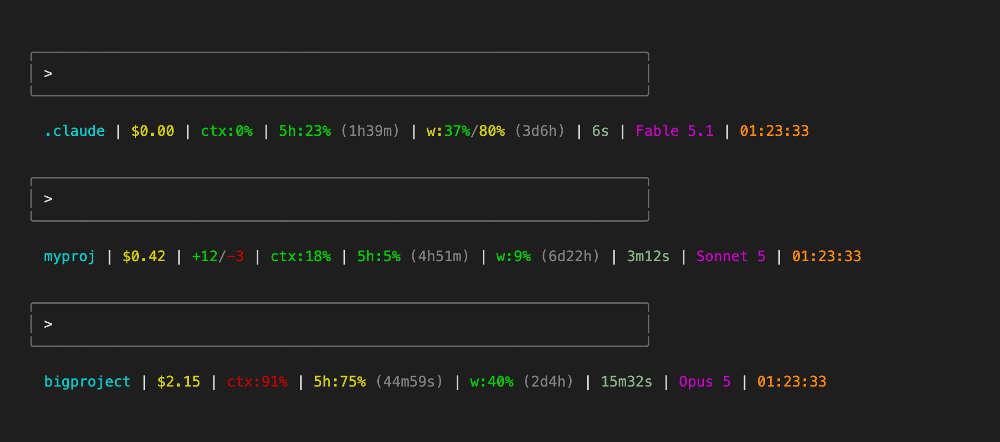

[English](README.md) | **Русский**

# claude-code-statusline

[](https://github.com/kskadart/claude-code-statusline/actions/workflows/ci.yml)

Строка состояния для [Claude Code](https://claude.com/claude-code). Она
появляется под чатом при каждом рендере и показывает папку проекта,
стоимость сессии и заполнение окна контекста. Также она показывает расход
5-часового и недельного лимита, время до их сброса, длительность сессии,
выбранную модель и часы. Устанавливается одним бинарником и одной строкой в
`settings.json`.



## Пример

```
.claude | $0.00 | ctx:0% | 5h:23% (1h39m) | w:37%/80% (3d6h) | 6s | Fable 5.1 | 12:30:13
```

Сегмент `+add/-del` появляется только тогда, когда в сессии были
добавлены или удалены строки; здесь у модели нет собственной строки
недельного расхода, поэтому `w` показывает только общее значение по всем
моделям:

```
myproj | $0.42 | +12/-3 | ctx:18% | 5h:5% (4h51m) | w:9% (6d22h) | 3m12s | Sonnet 5 | 09:04:21
```

## Что означает каждый сегмент

| Сегмент | Источник (поле JSON на stdin) | Значение | Цветовые пороги |
|---|---|---|---|
| dir | `workspace.current_dir` | Последний компонент пути; `~`, если он равен `$HOME`; скрыт, если папка неизвестна | голубой, без порогов |
| cost | `cost.total_cost_usd` | Стоимость сессии на данный момент, `$X.XX` | жёлтый, без порогов |
| `+add/-del` | `cost.total_lines_added` / `total_lines_removed` | Изменённые строки за сессию; скрыт, если оба значения — 0 | зелёный `+`, красный `-` |
| ctx | `context_window.used_percentage` | Заполнение окна контекста | зелёный <70, жёлтый 70–89, красный ≥90 |
| 5h | `rate_limits.five_hour.used_percentage`, `resets_at` | Расход 5-часового лимита и время до сброса (`XdYh` / `XhYm` / `XmYs` / `Xs` / `now`) | зелёный <70, жёлтый 70–89, красный ≥90 |
| w | `rate_limits.seven_day.used_percentage`, `resets_at` (все модели); `limits[]` эндпоинта usage (текущая модель) | Расход недельного лимита: сначала по всем моделям, затем `/` и собственный недельный расход текущей модели, если эндпоинт usage его сообщает; один таймер до сброса, если оба окна сбрасываются одновременно, иначе — отдельный таймер для каждого значения; полностью скрыт, если неизвестно ни одно из значений; при известном только расходе модели отображается как `w:-/NN%` (`-` — серым) | метка `w:` окрашивается по большему (худшему) из двух значений; процент по всем моделям — зелёный <70, жёлтый 70–89, красный ≥90; разделитель `/` и `-` — серым; процент модели — по её собственным порогам |
| duration | `cost.total_duration_ms` | Длительность сессии по часам | шалфейный, без порогов |
| model | `model.display_name`, при его отсутствии `model.id` | Выбранная модель; скрыт, если на stdin модель не указана | пурпурный, без порогов |
| clock | локальная `date` | Текущее местное время | оранжевый, без порогов |

## Требования

- Claude Code с поддержкой `statusLine`
- curl — нужен для фолбэка по лимитам и для недельного расхода по модели
  (оба пути — только для macOS, см. ниже)
- для разработки: Rust через [rustup](https://rustup.rs), а также jq, perl,
  shellcheck, bats

Основной путь (данные из stdin) работает на macOS и Linux. И фолбэк по
лимитам, и недельный расход по модели (см. ниже) — только для macOS, потому
что они читают Keychain через `security`. На Linux запрос по модели
пропускается, даже не пытаясь выполниться, так как `security` там нет в
PATH, а фолбэк молча не находит токен.

## Установка

### Готовый бинарник

Скачайте бинарник для своей платформы и добавьте блок `statusLine` в
`~/.claude/settings.json`. Варианты: `aarch64-apple-darwin`, `x86_64-apple-darwin`, `x86_64-unknown-linux-musl`, `aarch64-unknown-linux-musl`.

```bash
target=aarch64-apple-darwin  # выберите свой из списка выше
curl -fsSL "https://github.com/kskadart/claude-code-statusline/releases/latest/download/claude-code-statusline-$target.tar.gz" | tar -xz -C ~/.claude
```

```json
{
  "statusLine": { "type": "command", "command": "~/.claude/claude-code-statusline", "padding": 2 }
}
```

### Через Cargo

Если у вас есть Rust из [rustup](https://rustup.rs), соберите программу сами
и укажите путь к ней в `~/.claude/settings.json`:

```bash
cargo install --git https://github.com/kskadart/claude-code-statusline --locked
```

```json
{
  "statusLine": { "type": "command", "command": "~/.cargo/bin/claude-code-statusline", "padding": 2 }
}
```

Для обновления повторите те же шаги. Cargo сам заменит старую версию, а если у
вас уже последняя, пропустит установку; чтобы всё равно переустановить,
добавьте `--force`.

Если у вас стоял старый `statusline.sh`, удалите `~/.claude/statusline.sh` после смены команды.

## Настройка

- `CLAUDE_STATUSLINE_CACHE_DIR` — куда пишется кэш фолбэка по лимитам.
  По умолчанию: `~/.claude/cache`.
- `CLAUDE_STATUSLINE_MODEL_LIMIT` — установите `0`, чтобы отключить запрос
  недельного лимита по модели (см. ниже) и показывать в `w:` только общее
  значение по всем моделям. По умолчанию: включено.

## Как получаются данные о лимитах

1. В первую очередь: поле `rate_limits` в JSON, который Claude Code
   передаёт программе через stdin. В актуальных версиях Claude Code этого
   достаточно для сегментов `5h` и `w`, больше программе ничего не нужно.
2. Фолбэк, только если этого поля нет: программа читает OAuth-токен, который
   сам Claude Code хранит в Keychain macOS (элемент
   `Claude Code-credentials`), и запрашивает
   `https://api.anthropic.com/api/oauth/usage` с заголовком
   `anthropic-beta: oauth-2025-04-20`. Ответ кэшируется на 60 секунд в
   файле с правами `600`; таймаут запроса — 2 секунды.

   **Это неофициальный и недокументированный эндпоинт.** Он может
   измениться или исчезнуть без предупреждения. Токен отправляется
   только на `api.anthropic.com` и никуда больше, а в curl передаётся через
   stdin, поэтому не виден в `ps`. Если вам это не
   подходит — уберите запрос из `collect` в `src/main.rs` и пересоберите:
   путь через stdin продолжит работать сам по себе.

3. Собственный недельный расход текущей модели — второе значение сегмента
   `w:`, после серого `/` — в stdin вообще не приходит: в поле
   `rate_limits` от Claude Code нет разбивки по моделям. Программа определяет
   текущую модель из полей `model.display_name`/`model.id` на stdin — это
   то же имя, что показывает сегмент model. Как только имя модели известно, программа запрашивает
   недельный расход из массива `limits[]` того же ответа
   `https://api.anthropic.com/api/oauth/usage` (тот же OAuth-токен, та же
   оговорка про неофициальный эндпоинт, что и выше), не чаще одного раза
   за рендер, и берёт запись, относящуюся к текущей модели. Если в stdin
   уже было поле `rate_limits` (и этот запрос — единственная причина
   обращаться к эндпоинту), TTL кэша — 300 секунд вместо 60, то есть
   недельный расход модели обновляется не чаще раза в 5 минут. Правило
   сопоставления: берётся первая запись в `limits[]` с
   `kind == "weekly_scoped"`, у которой `scope.model.display_name`
   совпадает с текущей моделью без учёта регистра (`model.display_name` из
   stdin начинается с неё; если имени нет — `model.id` её содержит). Чтобы
   отключить этот запрос и видеть в `w:` только общее значение по всем
   моделям, как было до появления этой функции, установите
   `CLAUDE_STATUSLINE_MODEL_LIMIT=0`.

   curl учитывает `HTTPS_PROXY`/`CURL_CA_BUNDLE`; если вы за
   TLS-перехватывающим прокси, передайте curl его CA-сертификат через
   `CURL_CA_BUNDLE` — иначе запрос молча завершится неудачей и будет
   показано только общее значение по всем моделям.

4. Неудачный запрос (нет токена, ошибка curl, невалидный JSON) оставляет
   рядом с кэшем маркер `statusline-ratelimit.json.fail` (права `600`), из-за
   которого программа не повторяет попытку, пока этот маркер не станет старше
   того же TTL, что действует для кэша; успешный запрос его удаляет.
   Существующий более старый кэш при этом всё равно используется для
   рендера, даже если обновление пропущено или завершилось неудачей.

## Заметки о реализации

- Программа находится на горячем пути — вызывается на каждый рендер. Обычный
  рендер не запускает ни одного процесса: `security` и `curl` вызываются,
  только когда нужно обновить кэш. Никаких вызовов `git` (информация о ветке
  намеренно не показывается).
- При изменении раскладки сегментов обновите doc-комментарий к `render` в
  `src/render.rs`.
- Рабочий каталог самой программы — не рабочий каталог сессии: папка в
  выводе всегда берётся из `workspace.current_dir`.

## Разработка

```bash
cargo fmt --check
cargo clippy --all-targets -- -D warnings
cargo test
cargo build --release
bats tests/
shellcheck docs/render-screenshot.sh tests/stubs/*
```

Установите Rust через [rustup](https://rustup.rs), затем остальные инструменты:

```bash
# macOS
brew install shellcheck bats-core jq

# Debian/Ubuntu
sudo apt-get install -y shellcheck bats jq
```

Модульные тесты лежат рядом с кодом в `src/`. `tests/statusline.bats` проверяет
release-бинарник целиком.

Тесты никогда не обращаются к настоящему Keychain или сети:
`tests/stubs/security` и `tests/stubs/curl` — заглушки, подставленные в
начало `PATH`, а `HOME` и `CLAUDE_STATUSLINE_CACHE_DIR` указывают на
временные каталоги для каждого теста. См. `tests/statusline.bats` и
`tests/fixtures/`.

Пуш тега `vX.Y.Z`, совпадающего с версией в `Cargo.toml`, собирает все
платформы и публикует релиз на GitHub.

Чтобы перегенерировать `docs/screenshot.png`, соберите release-бинарник и
запустите `docs/render-screenshot.sh --render` (флаг `--render` обязателен, чтобы
получить PNG; без него скрипт только запишет `docs/screenshot.html`). Для
рендеринга нужен локальный Chrome или Chromium — если он не определяется
автоматически, укажите `CHROME_BIN`.

## Лицензия

MIT, см. [LICENSE](LICENSE).
